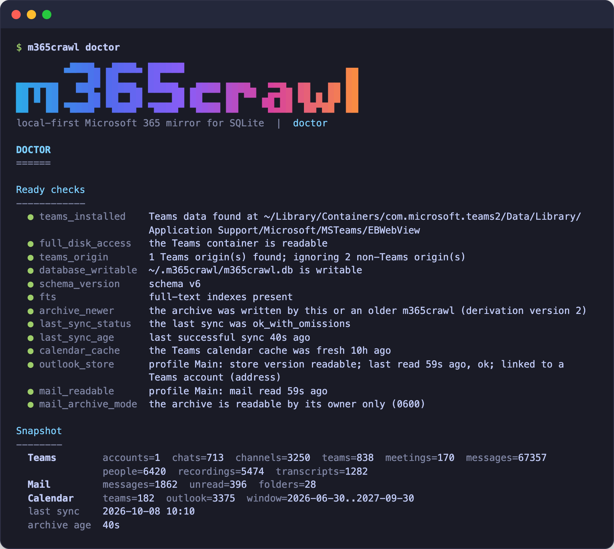

<!-- ourostack:brand:start -->
<p align="center">
  <a href="https://github.com/ourostack"></a>
</p>
<!-- ourostack:brand:end -->

# m365crawl — Your Microsoft 365 work, ready for your agents

[](https://github.com/ourostack/m365crawl/actions/workflows/ci.yml)
[](https://github.com/ourostack/m365crawl/releases/latest)
[](https://go.dev/)
[](https://github.com/ourostack/m365crawl/releases)
[](LICENSE)
[](https://github.com/ourostack/homebrew-tap)

Find the conversation. Recover the context. Walk into the meeting prepared.

`m365crawl` gives your agent one local, searchable archive of **Teams chats and channels**, **Outlook mail**, **meetings with their recaps and action items**, and **OneNote indexed notes**, plus inspectable **native Outlook people observations**. It captures what your signed-in desktop apps already cached, preserves history you synced, and returns focused results with IDs, links and coverage notes. Your agent can follow the work without opening every app or loading whole conversations into its context.

**Stable 1.x release.** The supported commands and machine-readable contracts are stable within 1.x; incompatible public changes require a new major version. [Compatibility and archive migration](SPEC.md#10-versioning-and-compatibility) define that promise. Stable does not mean complete Microsoft 365 coverage or identical native sources on every platform; the [source limits](#limits) still apply.

**Local reads. Explicit fetches. No writes to your apps.** Normal queries read the archive offline. Desktop capture does not extract app credentials or change Teams or Outlook storage. Meeting transcript text is fetched only when requested, through a browser with m365crawl's own profile; subsequent reads use the archived text. This is an archive of available data, not a complete export of your Microsoft 365 account.

<p align="center"></p>

*A real `m365crawl doctor` run: checks and archive counts only, with the home directory and profile names scrubbed.*

## Install

macOS, with Homebrew:

```sh
brew install ourostack/tap/m365crawl
```

Published macOS binaries are always Developer ID signed and notarized by Apple. Then give the app that runs m365crawl (your terminal, or the agent host app) Full Disk Access in System Settings › Privacy & Security › Full Disk Access, and quit and reopen that app. One grant covers Teams and Outlook; [why macOS asks](docs/full-disk-access.md).

Windows: download `m365crawl_<version>_windows_amd64.zip` or `m365crawl_<version>_windows_arm64.zip` from [GitHub Releases](https://github.com/ourostack/m365crawl/releases), unzip it under your user profile and run `m365crawl.exe`. Windows assets are intentionally unsigned; verify them with `checksums.txt` and `m365crawl.exe --json version`. No extra permission step is needed.

[`docs/install.md`](docs/install.md) covers the macOS tarballs, building from source (Go 1.27.3 or newer), verifying a download, upgrading and removing m365crawl. crawlkit's `crawlctl discover --app m365crawl` finds it.

## Quick start

```sh
m365crawl doctor
m365crawl sync
m365crawl
```

`doctor` checks every prerequisite, prints the exact app to grant when access is missing and exits 3 if a required check fails. `sync` reads Teams, Outlook mail and the calendar into the archive. `m365crawl` with no arguments shows what the archive holds, how fresh each source is and the commands to start with.

Then hand it to your agent. `m365crawl skill` prints a compact, version-matched workflow guide; every command's `--help` is complete without it. Ask for a concrete job:

> What needs my attention from the last week? Group unread chats by conversation, check unread and flagged mail, and cite the items you use.

> Prepare me for my next meeting. Show the agenda, attendees, meeting chat and related mail; tell me which fields or days are not cached.

> Find the discussion about the launch checklist, then open the relevant thread. Keep the first pass short and expand only the matches.

For an offline-only read, use `--no-sync`: ordinary reads can otherwise refresh the local desktop caches when the archive is stale. (`--max-age 0` still turns the sync off, but it does not mean fresh; `--no-sync` says what it does.) An explicit transcript fetch is a separate action, never a side effect of search. To try every command on synthetic data first, follow the [usage guide](docs/guide.md#try-it-on-synthetic-data).

## What your agent can do with it

| Ask | Command |
| --- | --- |
| What needs my attention? | `m365crawl unread` (chats) · `m365crawl mail unread` · `m365crawl mail list --flagged` |
| Find that thing someone sent me | `m365crawl search "budget review"` — chats and mail together, each hit labelled with its `source` |
| Show me the whole conversation | `m365crawl thread <link>` (Teams) · `m365crawl mail thread <id>` (the reply chain) |
| Prep me for my 2 pm | `m365crawl calendar` then `m365crawl calendar event <id>` — attendees, body, the meeting chat and related mail |
| Inspect the native evidence behind a meeting roster | Explicit `calendar attendees sync`, then offline `calendar attendees list <event>` and `show attendee-observation:N`; [keep source evidence separate from the displayed roster](docs/local-sources.md#native-meeting-attendee-evidence) |
| Which mails had the deck attached? | `m365crawl mail list --has-attachments` · `m365crawl mail show <id>` for each file's name, size and type |
| What's in the archive and how fresh is it? | `m365crawl` |
| Find my notes about that discussion | `m365crawl notes sync` once, then `m365crawl search "budget review"` or `m365crawl notes search "budget review"` |
| Read the note and check its coverage | `m365crawl notes show note:ID` · `m365crawl notes sources` |
| Find the document mentioned in that work | `m365crawl docs sync` once, then shared `search` or `docs search "words"` |
| Inspect the document claim, not a guessed file | `m365crawl docs show document-observation:ID` · `m365crawl docs sources` |
| Find text from a Loop component Teams cached | `m365crawl loop sync` once, then `m365crawl loop search "words"` or shared `search` |
| Inspect one cached Loop channel and its snapshot version | `m365crawl loop show loop-channel:ID` · `m365crawl loop sources` |
| Inspect the people evidence behind a name | `m365crawl people sync` once · `m365crawl people --query "name or address"` · `m365crawl people show person-observation:ID` |
| Review a retained own Teams compose body | `m365crawl drafts list`, then its guarded `full_inspection` in the declared `full_inspection_shell` (Windows: PowerShell7.3+, not CMD), or `drafts show teams-draft:HASH`; [cached projection, not current-unsent/editor truth](docs/commands.md#drafts) |

## What it covers

| Source | How it arrives | Details |
| --- | --- | --- |
| Teams chats, channels, activity, unread state and mentions | `sync`, from the new Teams app's cache | [Usage guide: Teams](docs/guide.md#teams) |
| Narrow own Teams cached regular-compose bodies | Archive-only `drafts list/show` over generic records already captured by ordinary sync; no new acquisition or shared-search inclusion | One fresh Mac Space/team-side body qualified; historical removed Chat shapes only, not current chat/UI/lifecycle or native Windows qualification |
| Outlook mail | `sync`, from new Outlook's cache on Mac and Windows | [Usage guide: Outlook mail](docs/guide.md#outlook-mail) |
| Calendar, recaps and action items | `sync`, from Teams and the new Outlook for Mac | [Usage guide: Calendar](docs/guide.md#calendar) |
| Native meeting attendee evidence | Explicit Mac HxStore discovery or supported copied profiles; registered lanes reuse an ordinary Outlook copy. Offline archive reads are portable, not native Windows/OWA qualification. | [Scope and workflow](docs/local-sources.md#native-meeting-attendee-evidence) |
| OneNote indexed notes, Office document metadata, cached Loop channels, native people observations | Their own explicit `notes`, `docs`, `loop` and `people sync` | [Notes, documents, people and Loop](docs/local-sources.md) |
| Meeting transcript text | Explicit `transcripts fetch`, through the tool-owned browser | [Commands: transcripts](docs/commands.md#transcripts) |
| Resident Office text, SharePoint pages, Stream transcripts, Engage Home sessions and selected threads | Explicit `content capture` or `content fetch` only. Acquisition is not yet qualified on native Windows and is not supported on Linux; offline archive reads are portable. | [Explicit content capture](docs/content.md) · [Engage Home](docs/engage-home.md) · [Selected thread](docs/commands.md#content-fetch-engage-thread) |

- **Start with the apps you already use.** Desktop capture needs no API token or app registration. It reads the signed-in apps' caches, with Full Disk Access on macOS.
- **Built for agent context budgets.** Every item carries a stable id, and every Teams item a deep link. `--fields` and `--max-text` return only what you need.
- **Query locally.** Search and recall read SQLite, with full-text search or plain SQL, instead of making a service request for each question. Explicit transcript fetch and sign-in use the tool-owned browser; desktop-app and browser access can still be governed by your organization's policies.
- **No message actions.** It cannot send, reply, react, move or mark messages read. Sync writes its own archive and private working files, not the source apps.
- **Keeps what the apps evict.** Teams and Outlook trim their caches as they run. The archive keeps history as long as you sync regularly, and marks mail that aged out of Outlook's cache as `evicted` instead of pretending it was deleted.

## Scope and requesting support

m365crawl is a complement to Graph and MCP tools, not a replacement: use those to send or react, retrieve data the desktop apps never cached, or work on an unsupported host or app. Support grows from the maintainer's own Microsoft 365 usage, so the name is the direction, not a claim that every app is supported. [`docs/scope.md`](docs/scope.md) separates shipped support from planned and deferred sources.

**Missing something you use?** Work with your agent to open a [prompt request](https://github.com/ourostack/m365crawl/issues/new?template=prompt-request.yml): describe the job you want the agent to do, the app, your operating system and what happens today. Search [existing issues](https://github.com/ourostack/m365crawl/issues) first, and never attach real mail, chats, cache files, archives, credentials or tokens.

## Privacy

The archive holds your real chats, mail, meetings and explicitly retained cloud content. It stays in a private directory (`~/.m365crawl/` on macOS, `%LOCALAPPDATA%\m365crawl\` on Windows). Only explicit `transcripts fetch`, `transcripts signin`, `content fetch page/stream` and `content signin URL` reach SharePoint through the tool-owned browser; m365crawl never sees a password or token. Ordinary content reads are archive-only regardless of max-age and never fetch or sign in. Other reads use the local archive or desktop caches. Treat the database like the mailbox it contains: do not commit it, sync it to shared storage or paste it into tools you would not show the original messages to. Tests and examples use synthetic data; the doctor screenshot above is a real, scrubbed run that shows only checks and counts. [`docs/privacy.md`](docs/privacy.md) lists what is read, what is stored and what is never touched.

## Limits

- It sees only what the desktop apps cached, so sync regularly.
- Supported: macOS and Windows with the new Teams app, plus new Outlook's cached mail and calendar on Mac and Windows. OWA calendar retains source uncertainty and does not infer deletions; several content mailboxes in one Windows profile are each read into their own account. Classic Teams and classic Outlook are not supported. Linux can read archives and explicit copied supported sources, but desktop-cache discovery is not supported.
- Read-only: no sending, replying, reacting, moving or marking read.
- Attachments are recorded as metadata; their bytes are not copied into the archive.
- Mac Outlook's local store does not separate To from Cc; Windows preserves To/Cc/Bcc roles and cached conversation identities. Importance is read but not yet verified against Outlook's own display.
- The calendar holds only the days Teams cached plus what Outlook's store holds, and attendees, body and rooms only for meetings someone opened.
- Contact stores, call history and pinned-message lists have no typed commands yet; they are mirrored as raw records, readable with `stores` and `records`.
- The apps can change their storage layout. When they do, `sync` fails with a named error or reports counted omissions instead of guessing.

## Documentation

- [`docs/guide.md`](docs/guide.md): a synthetic-data walkthrough, then Teams, mail, the calendar and the output contract for agents.
- [`docs/commands.md`](docs/commands.md): every command and flag.
- [`docs/local-sources.md`](docs/local-sources.md): OneNote notes, document metadata, people observations and cached Loop channels.
- [`docs/content.md`](docs/content.md) and [`docs/engage-home.md`](docs/engage-home.md): explicit Office, SharePoint, Stream and Engage capture.
- [`docs/install.md`](docs/install.md): install, upgrade, verify and remove.
- [`docs/full-disk-access.md`](docs/full-disk-access.md): why macOS asks and how to grant it.
- [`docs/privacy.md`](docs/privacy.md): what m365crawl reads, stores and never touches.
- [`docs/troubleshooting.md`](docs/troubleshooting.md): common problems and their fixes.
- [`docs/scope.md`](docs/scope.md): shipped support, the roadmap and prompt requests.
- [`docs/how-it-works.md`](docs/how-it-works.md): from the app caches to a SQLite row.
- [`docs/outlook-store.md`](docs/outlook-store.md): the Outlook for Mac store layout, structure and counts only.
- [`SPEC.md`](SPEC.md): the normative specification.
- [`docs/releasing.md`](docs/releasing.md), [`CHANGELOG.md`](CHANGELOG.md) and [`docs/releases/`](docs/releases/): how a release is made and what changed in each.
- [`AGENTS.md`](AGENTS.md): rules for agents working on this repository.

## How it works

m365crawl copies each app's cache to a private temporary location, decodes the copy with a built-in reader (LevelDB, IndexedDB and V8 for Teams and for Outlook's OWA cache on Windows; the `HxStore.hxd` block store for Outlook on Mac), and writes typed rows with full-text indexes into SQLite. Anything whose name looks like sign-in credentials is counted and never opened, and every copy is removed on every exit path. [`docs/how-it-works.md`](docs/how-it-works.md) has the details.

## Development

```sh
make build      # bin/m365crawl
make test       # unit tests with the race detector
make e2e        # end-to-end tests against the committed fixtures
make coverage   # 100% coverage gate on internal/...
make check      # every gate CI runs: tidy, fmt, vet, lint, test, coverage, e2e
```

The tests run against two committed synthetic fixtures. `testdata/teams-fixture/` is an IndexedDB cache written by a real Microsoft Edge through `scripts/fixture/`; regenerate it with `make fixture` (needs Node and Edge) and the V8 test vectors with `make v8vectors` (needs Node 22). `testdata/outlook-fixture/` holds Outlook stores written by `scripts/hxfixture`, and `scripts/hxshowcase` writes the showcase store with mail that `make screenshot` syncs. Real-cache acceptance (`M365CRAWL_REAL_CACHE=1 make acceptance`) runs locally only; it needs Full Disk Access on macOS, live app caches, Node 22, python3 and the reference-reader clones documented in [`AGENTS.md`](AGENTS.md). Its results are recorded as counts, timings and pass/fail only, never content.

## Credits

- [slacrawl](https://github.com/openclaw/slacrawl) (openclaw, MIT) is the model for this tool's design and commands, and the source of the terminal renderer.
- [ccl_chromium_reader](https://github.com/cclgroupltd/ccl_chromium_reader) (MIT) documented the Chromium IndexedDB and V8 formats and served as the reference decoder.
- [hxstore-reverse-engineering](https://github.com/ukd1/hxstore-reverse-engineering) (MIT) documented the Outlook store's block container.

## License

MIT. See [LICENSE](LICENSE).
