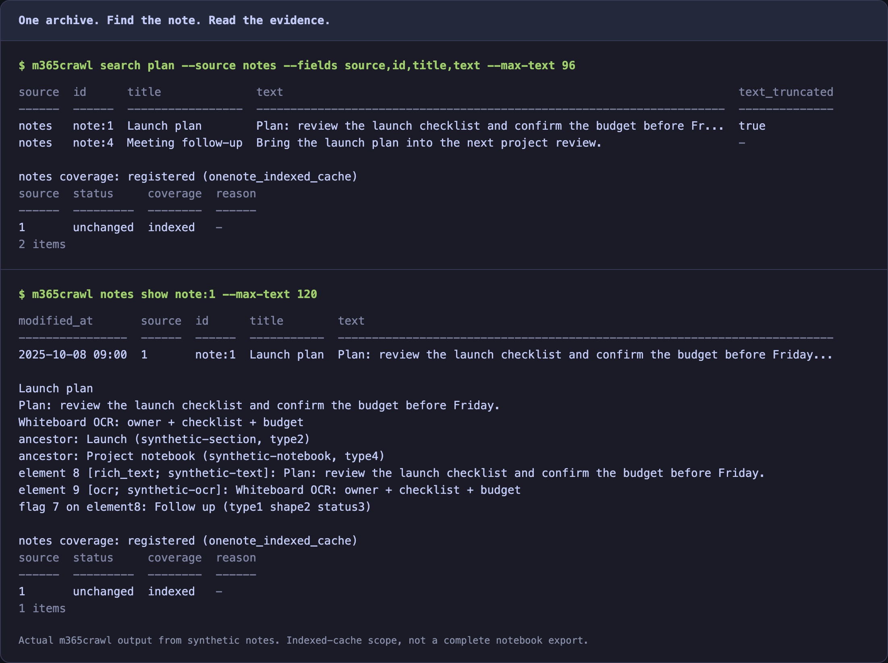
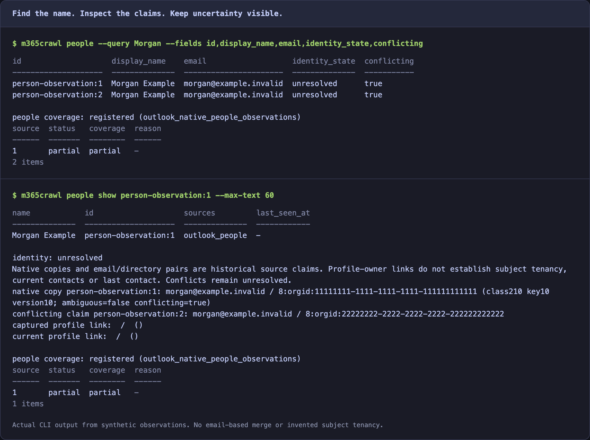

# m365crawl — Your Microsoft 365 work, ready for your agents

[](https://github.com/ourostack/m365crawl/actions/workflows/ci.yml)
[](https://github.com/ourostack/m365crawl/releases)
[](https://go.dev/)
[](https://github.com/ourostack/m365crawl/releases)
[](LICENSE)
[](https://github.com/ourostack/homebrew-tap)

Find the conversation. Recover the context. Walk into the meeting prepared.

`m365crawl` gives your agent one local, searchable archive of **Teams chats and channels**, **Outlook mail**, **meetings with their recaps and action items**, and **OneNote indexed notes**, plus inspectable **native Outlook people observations**. It captures what your signed-in desktop apps already cached, preserves history you synced, and returns focused results with IDs, links and coverage notes. Your agent can follow the work without opening every app or loading whole conversations into its context.

**Local reads. Explicit fetches. No writes to your apps.** Normal queries read the archive offline. Desktop capture does not extract app credentials or change Teams or Outlook storage. Meeting transcript text is fetched only when requested, through a browser with m365crawl's own profile; subsequent reads use the archived text. This is an archive of available data, not a complete export of your Microsoft 365 account.

<p align="center"></p>

## What your agent can do with it

| Ask | Command |
| --- | --- |
| What needs my attention? | `m365crawl unread` (chats) · `m365crawl mail unread` · `m365crawl mail list --flagged` |
| Find that thing someone sent me | `m365crawl search "budget review"` — chats and mail together, each hit labelled with its `source` |
| Show me the whole conversation | `m365crawl thread <link>` (Teams) · `m365crawl mail thread <id>` (the reply chain) |
| Prep me for my 2 pm | `m365crawl calendar` then `m365crawl calendar event <id>` — attendees, body, the meeting chat and related mail |
| Which mails had the deck attached? | `m365crawl mail list --has-attachments` · `m365crawl mail show <id>` for each file's name, size and type |
| What's in the archive and how fresh is it? | `m365crawl` |
| Find my notes about that discussion | `m365crawl notes sync` once, then `m365crawl search "budget review"` or `m365crawl notes search "budget review"` |
| Read the note and check its coverage | `m365crawl notes show note:ID` · `m365crawl notes sources` |
| Find the document mentioned in that work | `m365crawl docs sync` once, then shared `search` or `docs search "words"` |
| Inspect the document claim, not a guessed file | `m365crawl docs show document-observation:ID` · `m365crawl docs sources` |
| Find text from a Loop component Teams cached | `m365crawl loop sync` once, then `m365crawl loop search "words"` or shared `search` |
| Inspect one cached Loop channel and its snapshot version | `m365crawl loop show loop-channel:ID` · `m365crawl loop sources` |
| Inspect the people evidence behind a name | `m365crawl people sync` once · `m365crawl people --query "name or address"` · `m365crawl people show person-observation:ID` |

## Give your agent the context, not another inbox

- **Start with the apps you already use.** Desktop capture needs no API token or app registration. It reads the signed-in apps' caches, with Full Disk Access on macOS and the local access rules described below.
- **Built for agent context budgets.** Every item carries a stable id, and every Teams item a deep link. `--fields` and `--max-text` return only what you need.
- **Query locally.** Search and recall read SQLite instead of making a service request for each question. Explicit transcript fetch and sign-in use the tool-owned browser; desktop-app and browser access can still be governed by your organization's policies.
- **No message actions.** It cannot send, reply, react, move or mark messages read. Sync writes its own archive and private working files, not the source apps.
- **Keeps what the apps evict.** Teams and Outlook trim their caches as they run. The archive keeps history as long as you sync regularly, and marks mail that aged out of Outlook's cache as `evicted` instead of pretending it was deleted.
- **One place for everything.** Chats, mail, the activity feed, unread state, mentions and meetings sit in one database that an agent can query with full-text search or plain SQL.

**A complement to Graph and MCP tools, not a replacement for every job.** Use those tools when you need to send or react, retrieve data the desktop apps never cached, or work on an unsupported host or app. Keep m365crawl for local recall, archive search and context-building from the sources it actually covers. Missing or stale cache data stays visible rather than becoming a claim that the work does not exist.

## Scope and requesting support

m365crawl is built around the maintainer's own Microsoft 365 usage: support grows from data we can inspect and workflows we can test on real machines. The name is the direction, not a claim that every Microsoft 365 app is supported. Your apps, account configuration and cached history may differ.

**Available now:** Teams chats and channels, Outlook mail on macOS and Windows, the calendar, meeting recaps and action items, meeting transcript text through an explicit browser fetch, local OneNote indexed notes, and source-qualified Outlook people observations. The platform differences and cache limits are described below; an archived recap action item is not a Planner or To Do task, and a native people observation is not a resolved directory identity.

**OneNote, without pretending an index is a notebook export.** `notes sync` registers the available Mac indexes; `notes sync --root DIR` accepts supported rollback-mode index copies on Mac, Windows and Linux. Shared search joins their titles, text and OCR to conversations and mail. `notes show note:ID` preserves native elements, flags and hierarchy; `notes sources` shows coverage, failures and last-good capture. Partial or failed captures keep prior text. No original visual layout, page web link, author or tenant ownership is invented. Native Windows app-cache discovery and live WAL capture remain deferred.

<p align="center"></p>

*Find the note, then read the evidence. This example is actual CLI output from synthetic notes, not private work data or a complete notebook export.*

**People observations, without invented identity resolution.** `people sync` registers native Mac Outlook HxStore inputs, and `people --query` joins retained observations to the existing people list. `people show person-observation:ID` exposes native email/directory claims, differing copies and conflicts; `people sources` shows independent coverage. Copied supported HxStore roots work with `--root`. Windows OWA people discovery and automatic subject-tenant resolution are not supplied. A profile-owner link is not the subject's tenant, a cache refresh is not last contact, and ambiguous copies remain unresolved rather than becoming a guessed current contact.

<p align="center"></p>

*Find the name, inspect the claims, and keep uncertainty visible. These are synthetic observations, not private contacts or a directory export.*

**Document evidence, without opening the document.** `docs sync` captures available Mac Office recent/shared/recommended/dialog metadata; shared search then connects native titles, URLs and sharing/person claims to the conversation. Follow `document-observation:ID` with `docs show`, narrow lists with `--application Word|Excel|PowerPoint` and `--surface recent|shared|recommended|dialog`, and inspect `docs sources` for losses, failed inputs with their remedy, and retained claims. Explicit ordinary local JSON copies use `docs sync --root DIR`; provider/placeholder and linked inputs are refused. `docs sync` also reads the Mac Office registry's recently-opened list, and `docs sync --registry-file FILE` reads one ordinary local copy of a registry file: those rows carry the registry's own opened time (`opened_at`, null when it does not parse) and no modification time, so date filters never match them. `docs sync` also reads OneDrive's local usage file on Mac, and `docs sync --onedrive-usage-file FILE` reads one ordinary local copy of it on Mac or Windows: recently used files, their formatted variants with the sharing claims OneDrive recorded, and frequent-collaborator profiles (`--application onedrive`, `usage_native`). Sharing history and participants are previewed at 100 with full counts, each row prints the command that shows its complete stored record, and the names, addresses and thread IDs in it stay the file's claims, never linked to an archived person or chat. A usage file with a write-ahead log beside it is refused rather than consolidated. Metadata is not document text, a resolved file identity, current sharing or proof of local residency. Native URLs and friendly paths are never opened or hydrated, and identical sharing claims are not counted as new events. Start from `docs --help`: the embedded guide adds workflow strategy, not missing command contracts.

```text
$ m365crawl --fields id,title,application,surface,opened_at,text_state docs list --query Orion
id                      title                           application  surface  opened_at             text_state
----------------------  ------------------------------  -----------  -------  --------------------  ------------
document-observation:3  Synthetic Orion budget draft    registry     -        2026-10-09T12:34:56Z  not_captured
document-observation:1  Synthetic Orion planning notes  supplied     recent   -                     not_captured
document-observation:2  Synthetic Orion shared plan     supplied     shared   -                     not_captured

documents coverage: registered (office_document_metadata)
source  kind             status    coverage      locator                                         reason
------  ---------------  --------  ------------  ----------------------------------------------  ------
1       office_recent    complete  observations  office/recent.json                              -
2       office_shared    complete  observations  office/shared.json                              -
3       office_registry  complete  observations  registry/MicrosoftRegistrationDB_synthetic.reg  -
3 items

$ m365crawl --fields id,title,variant,opened_at,modified_at,association_state,text_state docs show document-observation:3
id                      title                         variant          opened_at             modified_at  association_state  text_state
----------------------  ----------------------------  ---------------  --------------------  -----------  -----------------  ------------
document-observation:3  Synthetic Orion budget draft  office_registry  2026-10-09T12:34:56Z  -            unresolved         not_captured

documents coverage: registered (office_document_metadata)
source  kind             status    coverage      locator                                         reason
------  ---------------  --------  ------------  ----------------------------------------------  ------
3       office_registry  complete  observations  registry/MicrosoftRegistrationDB_synthetic.reg  -
1 items
```

*Find the claim, inspect the source, and leave unresolved links unresolved. This is actual output of this version from synthetic Office JSON files and a synthetic registry file (times in UTC), not private documents or a library export.*

**Cached Loop channels, as partial snapshots.** `loop sync` projects the channel text of Loop snapshot records Teams already cached and `sync` already archived; nothing is fetched and Loop is never opened. Shared search and `loop search` return stable `loop-channel:ID` rows to follow with `loop show`. Each row is one channel of one immutable snapshot version, with its native sequence, pending-operation count and whether the archived record still matches it: partial text, not a full or current page, table, author or history. `loop sync` takes 128 new records per run and says when to run it again. `loop sources` shows every registration, including failed and metadata-only ones, with the retry command.

**Planned expansion, not shipped support:**

| Area | Direction | What still needs proving |
| --- | --- | --- |
| People resolution and meetings | Qualify subject-scoped identity links and read fuller attendee lists | Positive subject tenancy, current-copy ambiguity, source coverage and platform-specific mappings |
| Office and OneDrive | Resolve file/library associations and add separately qualified local document text | Provider/residency evidence, ambiguous identities and Windows-specific sources; metadata alone is not file or text access |
| More OneNote coverage | Qualify additional native app layouts and page links | Windows app-cache discovery, coherent WAL capture and account-qualified page URLs; an index is not a complete notebook export |
| Archived bot citations and Loop | Expose citations in archived bot replies; link cached Loop channels to their pages, messages and authors | Preserve Teams provenance, snapshot versions and partial coverage; cached channel text is not a full page, and this is not private Copilot history |
| Browser-backed content | Read cloud document text, Stream transcripts, SharePoint pages and News, and used Engage surfaces | A tested read path and archive integration for each service; transcript fetching does not prove another service works |

**Not included in the current expansion:** assigned Planner/To Do tasks and private Copilot history. Our probes have not established a representative, account-qualified read contract for those sources. Recap action items are not assigned tasks, and Teams bot citations are not private Copilot history. Parsing OneDrive's local sync-cache database is backend groundwork only: coherent capture while OneDrive is changing that database is not yet qualified. This limitation concerns OneDrive's cache, not m365crawl's existing `sync` command.

Lists can follow a working SharePoint reader when there is data and a concrete use. Forms, Whiteboard, Viva Insights and separate Bookings support are deferred: they are not part of the current implementation commitment. Security and identity apps are outside the work-content scope. These are priorities, not declarations that those products can never be supported.

The goal is one connected archive, not an unrelated crawler per app. New sources should improve shared search, people resolution or links between work items, preserve the distinction between cached and fetched data, and make missing or stale content visible. Planned capabilities will be documented as available only after they ship and their platform support is verified.

**Missing something you use? Work with your agent to open a GitHub issue as a "prompt request".** Describe the job you want the agent to do, the Microsoft 365 app, your operating system and app version, and what happens today. Your agent can help check whether a readable cache or a browser read path exists, but you do not need to reverse-engineer it or submit code before asking.

For example:

> Add support for my Microsoft 365 app so my agent can answer this question: [the job]. I use [app and version] on [operating system]. Today m365crawl [what it does or cannot do]. Please investigate the available data, explain any coverage limits, and propose how it would join the existing archive.

Search [existing issues](https://github.com/ourostack/m365crawl/issues) first, then [open a prompt request](https://github.com/ourostack/m365crawl/issues/new?template=prompt-request.yml). The form starts with the job you want your agent to do; technical evidence is optional. Requests help choose the next integrations; they are not a promise of support or a delivery date. Do not attach real mail, chats, document contents, cache files, archive databases, credentials or tokens to public issues. Use synthetic examples and non-sensitive counts, formats and field names.

## Install

### macOS

```sh
brew install ourostack/tap/m365crawl
```

Published macOS binaries are always Developer ID signed and notarized by Apple; the release workflow fails rather than ship an unsigned build. The Homebrew cask clears the quarantine flag after install. If you built m365crawl yourself, you may need `xattr -dr com.apple.quarantine m365crawl` once.

[GitHub Releases](https://github.com/ourostack/m365crawl/releases) has `m365crawl_<version>_darwin_arm64.tar.gz` and `m365crawl_<version>_darwin_amd64.tar.gz` with `checksums.txt`. To build from source, install Go 1.27 or newer:

```sh
go install github.com/ourostack/m365crawl/cmd/m365crawl@latest
```

### Windows

Download `m365crawl_<version>_windows_amd64.zip` or `m365crawl_<version>_windows_arm64.zip` from [GitHub Releases](https://github.com/ourostack/m365crawl/releases), unzip it under your user profile and run `m365crawl.exe`. Add that directory to `PATH` to call it without the full path. Windows assets are intentionally unsigned; verify them with `checksums.txt` and `m365crawl.exe --json version`.

On Windows, m365crawl reads Teams chats, the Teams calendar and new Outlook's OWA cached mail under `%LOCALAPPDATA%\Microsoft\Olk\EBWebView`. Mail commands, search, overview, status and doctor work with that cache. OWA calendar is not read in this release; Windows OWA calendar support is planned.

crawlkit's `crawlctl discover --app m365crawl` finds it.

### macOS: grant Full Disk Access

macOS protects the Teams and Outlook containers, so the app that runs m365crawl needs Full Disk Access. Open System Settings › Privacy & Security › Full Disk Access, turn it on for your terminal (or the agent host app that starts m365crawl), then quit and reopen that app. Check with:

```sh
m365crawl doctor
```

`doctor` checks every prerequisite, prints the exact app to grant when access is missing and exits 3 if a required check fails. One grant covers Teams and Outlook. On Windows the caches live under `%LOCALAPPDATA%` and need no extra step.

[`docs/install.md`](docs/install.md) covers upgrades, verifying a download and removing m365crawl.

## Start with your agent

After installing, check access and build the archive:

```sh
m365crawl --help
m365crawl doctor
m365crawl sync
```

If you use OneNote on Mac, add its locally indexed notes explicitly:

```sh
m365crawl notes sync
m365crawl notes sources
m365crawl search "launch checklist"
m365crawl notes show note:ID
```

Ordinary note reads refresh registered sources only. New indexes need another explicit `notes sync`; `--max-age 0` performs no capture. Account, author, chat-only and mail-only filters exclude unresolved notes from combined search with a notice. Use `--source notes` for an independent notes-only search that does not require Teams or Outlook.

Start with command help and focused queries. For a compact, version-matched workflow guide, run `m365crawl skill` and give its output to your agent. The guide supplements help; basic options, scope and follow-ups should not depend on it. Then ask for a concrete job:

> What needs my attention from the last week? Group unread chats by conversation, check unread and flagged mail, and cite the items you use.

> Prepare me for my next meeting. Show the agenda, attendees, meeting chat and related mail; tell me which fields or days are not cached.

> Find the discussion about the launch checklist, then open the relevant thread. Keep the first pass short and expand only the matches.

For an offline-only read, use `--max-age 0`: ordinary reads can otherwise refresh the local desktop caches when the archive is stale. An explicit transcript fetch is a separate action, never a side effect of search.

## Quick start

These examples run against synthetic data from the repository, so every name and message is made up: the committed Teams fixture, and a showcase Outlook store with mail and meetings that `scripts/hxshowcase` writes (the same store `make screenshot` uses). From a clone, build that store and point m365crawl at both and at a scratch archive:

```sh
tmp="$(mktemp -d)"
go run ./scripts/hxshowcase -out "$tmp/outlook"
export M365CRAWL_TEAMS_ROOT="$PWD/testdata/teams-fixture/EBWebView"
export M365CRAWL_OUTLOOK_ROOT="$tmp/outlook"
export M365CRAWL_DB="$tmp/m365crawl.db"
```

On Windows, in PowerShell (Teams fixture only):

```powershell
$env:M365CRAWL_TEAMS_ROOT = (Resolve-Path '.\testdata\teams-fixture\EBWebView').Path
$env:M365CRAWL_DB = Join-Path $env:TEMP 'm365crawl-fixture.db'
```

Against your own Microsoft 365, skip those lines. Then:

```sh
m365crawl sync
m365crawl
m365crawl search planning
m365crawl mail unread
m365crawl mail show outlook/Main:3001
m365crawl calendar --days 14
m365crawl calendar event ev_2da7280856
```

`m365crawl` with no arguments prints an overview: what the archive holds per source (chats, mail, calendar, documents, notes, Loop channels, people and transcripts), how fresh each one is, and the commands to start with. Documents, notes and Loop channels that were never registered say which sync command adds them, and failed sources point to their `sources` command. `people --help` explains the recency column, the ID kinds and the `--account` value without needing a guide. Text times carry their zone (`2026-10-08 02:51 PDT`); JSON times are UTC.

Here is what three of those commands print. The output comes from a run against the same synthetic data; the dates follow the day you build the showcase store.

`m365crawl` (the overview):

```
        ▄████▄ ▄████▄ ██████                           ▄▄
            ██ ██     ██                               ██
██▀█▀██   ███▀ █████▄ █████▄ ▄████ ████▄  ▀▀█▄ ██   ██ ██
██ █ ██     ██ ██  ██     ██ ██    ██ ▀▀ ▄█▀██ ██ █ ██ ██
██   ██ ▀████▀ ▀████▀ ▀████▀ ▀████ ██    ▀█▄██  ██▀██  ██
local-first Microsoft 365 mirror for SQLite  |  overview

source       state           holds                                                             last sync
-----------  --------------  ----------------------------------------------------------------  --------------------
chats        ok              120 messages in 14 conversations, newest 2023-12-05 10:31 PST     2026-10-08 02:51 PDT
mail         ok              37 messages from 2026-09-24, newest 2026-10-08 02:39 PDT          2026-10-08 02:51 PDT
calendar     ok              44 events from 2023-11-20 to 2026-10-23; today not fully covered  2026-10-08 02:51 PDT
documents    not_registered  no sources registered                                             -
notes        not_registered  no sources registered                                             -
loop         not_registered  2 archived records; no sources registered                         -
people       ok              10 people (Teams and mail); no native Outlook people sources      2026-10-08 02:51 PDT
transcripts  empty           no recorded meetings                                              -
calendar: today is not fully covered by cached calendar data: run m365crawl sync, or open the calendar in Teams or Outlook
documents: no Office document sources registered: run m365crawl docs sync (Mac Office) or docs sync --root DIR
notes: no OneNote indexes registered: run m365crawl notes sync, or notes sync --root DIR
loop: 2 cached Loop records are archived and none is registered: run m365crawl loop sync
transcripts: no recorded meetings in the archive yet: run m365crawl sync

Start here:
  m365crawl sync              read Teams, Outlook mail and the calendar into the archive
  m365crawl                   what the archive holds and how fresh it is
  m365crawl search "words"    search chats, mail, fetched transcripts, notes, document metadata and Loop text
  m365crawl calendar          today's meetings; calendar event <id> for one meeting with its chat and mail
  m365crawl mail unread       unread mail by folder
  m365crawl unread            unread Teams chats
  m365crawl mail list --has-attachments   mail with files; mail show <id> lists each file's name, size and type
  m365crawl docs list         Office recent, shared and recommended document metadata and OneDrive usage records; docs sync registers the sources
  m365crawl notes search "words"   OneNote indexed notes; notes sync registers the indexes
  m365crawl loop search "words"   cached Loop channel text (partial snapshots); loop sync registers the archived records
  m365crawl people            Teams people, mail correspondents and native Outlook people observations
```

`m365crawl search planning --limit 4`: chats and mail together, newest first, with the `thread` to open next:

```
at                    source  where                      who           thread                                          text
--------------------  ------  -------------------------  ------------  ----------------------------------------------  ---------------------------------------------
2026-10-07 00:51 PDT  mail    Inbox                      Casey Brooks  outlook/Main:3007                               Q4 planning offsite agenda - Draft agenda ...
2026-10-03 00:51 PDT  mail    Sent Items                 Riley Chen    outlook/Main:3023                               Re: Q4 planning offsite agenda - Added a s...
2023-11-14 14:14 PST  chats   Fixture team 1 › Planning  Pat Example   19:planningchannel1@thread.tacv2 1700000047000  Planning channel message
2023-11-14 14:14 PST  chats   Fixture team 2 › Planning  Pat Example   19:planningchannel2@thread.tacv2 1700000047000  Planning channel message

4 items
archive age: 1m15s
```

`m365crawl mail show outlook/Main:3001 --json --max-text 200`:

```json
{"id":"outlook/Main:3001","account":"outlook/Main","folder":"Inbox","folder_kind":"inbox","to_me":false,"subject":"Launch checklist: final review","from_name":"Sam Ortiz","from_address":"sam.ortiz@example.test","recipients":[{"name":"Riley Chen","address":"riley.chen@example.test","kind_raw":1}],"in_reply_to":null,"received_at":"2026-10-08T09:39:00Z","sent_at":"2026-10-08T09:38:00Z","is_read":false,"read_state":"unread","flag":"none","importance":"high","has_attachments":true,"attachments":[{"name":"launch-checklist.pdf","size":49000,"content_type":"application/pdf","inline":false,"downloaded":true}],"preview":"Everything is green except the docs pass. Can you take a last look before 3?","body_text":"Everything is green except the docs pass. Can you take a last look before 3? Sam Ortiz","body_state":"inline","internet_message_id":"<showcase-001@example.test>","ical_uid":null,"gone_at":null,"evicted_at":null,"synced_at":"2026-10-08T09:51:45.16Z","archive_age_seconds":58}
```

Output is JSON when stdout is not a terminal and readable text on a terminal. Force either with `--format json|text`.

## Teams

m365crawl reads chats, channels, meeting chats, the activity feed, unread state and mentions from the new Teams app's cache. The Teams commands keep their short names: `messages`, `unread`, `thread`, `conversations`, `teams`, `activity` and `people`. `messages`, `thread` and `unread` cover Teams chats and channels only; for Outlook mail use `m365crawl mail …`.

```sh
m365crawl unread --since 7d --by-conversation
m365crawl activity --unread
m365crawl thread 19:topicchannel1@thread.tacv2 1700000045000
m365crawl messages --team "Fixture team 1" --since 2023-11-14 --max-text 80
```

- **Deep links.** Every message and activity item carries a `link`, a Teams deep link you can cite or open. `thread` accepts such a link in place of the conversation and root id.
- **Threads.** In text output, `messages` and `search` have a `thread` column with the two arguments `thread` takes: `<conversation_id> <reply_chain_id, else id>`. For mail, the column holds the id that `mail thread` takes.
- **Mentions.** An @-mention shows in `text` as the person's plain name. `mentions` lists who was mentioned, `mentions_me` is exact and `mention_kind` (`person`, `channel`, `team`, `tag`, `everyone`) says how you were mentioned. `--direct-mentions` keeps only `person` mentions.
- **System pseudo-conversations.** `48:notifications`, `48:calllogs` and `48:annotations` duplicate real messages, so they are hidden by default; `--include-system` brings them back. Bot cards, call events and thread events read as plain text (`Call ended · 23m`), never raw JSON.
- **Unread.** Channels are left out of `unread` by default because their unread counts are noise; `--include-channels` adds them. Use `--since` for "what needs my attention", because old read markers leave stale chats with hundreds of unread messages.
- **App and citation evidence.** Each Teams message item carries `app_observation`: the app, reply and citation claims of its archived native JSON (for example a bot reply with its cited sources), with a state of `mapped`, `partial`, `absent`, `failed` or `not_derived`. The result's `application_evidence_coverage` counts those states for the messages it returned, and its `posted_by_app` counts the ones that name an app; `--fields app_summary` gives the compact form. The claims are the message's own, not a verified app identity, and a message stays one item. The first sync after upgrading derives this evidence offline from the archive.
- **Accounts.** `--account <tenantId>/<userId>` limits any command to one signed-in account; `m365crawl whoami` lists them.

### Watch for changes

`watch` streams changes as Teams writes them. It prints JSON Lines (one object per line, the one exception to the one-document rule): a `message` or `activity` line per change, then a `sync` line per sync. The first sync is a silent baseline, so only later changes appear; `--emit-initial` prints that one too.

```sh
m365crawl watch --fields id,type,text,sender_name --max-text 200
```

Run it in the background and read its stdout; Ctrl-C (or SIGTERM) stops it with exit 0. A change reaches the output after Teams flushes it to its cache plus a few seconds of debounce. Measured against a real cache, that was about 12 to 32 seconds from the moment a message was sent.

## Outlook mail

m365crawl reads messages, folders, read and flag state, recipients, attachments (as metadata) and bodies as text from new Outlook's local cache: HxStore on Mac and OWA IndexedDB on Windows. Explicit supported copied OWA roots work portably. Windows exposes ordered To/Cc/Bcc roles and conversation identities; Mac roles and missing conversation identities are null. Cache coverage is not server history or server totals. See [source differences](docs/outlook-store.md#windows-owa-cached-mail) for unavailable fields, layout refusals and calendar limits.

```sh
m365crawl mail list --folder inbox --unread
m365crawl mail list --from pat --since 7d
m365crawl mail show <id>
m365crawl mail thread <id>
m365crawl mail folders
m365crawl mail unread
```

- **What the cache holds.** Outlook keeps a window of recent mail per folder. Every mail result says when mail was last synced and how far back the cache reaches (`cache covers since …`). Mail you synced earlier stays in the archive when Outlook drops it from the cache and is marked `evicted`. A message deleted in Outlook is marked `gone` once two reads in a row miss it. Both are hidden unless you pass `--include-evicted` or `--include-gone`.
- **Unread counts can be lower than Outlook's**, because the local cache does not hold every message the server knows about. The output says so.
- **Threads.** Outlook keeps no thread id locally, so `mail thread` follows reply links (In-Reply-To and Message-ID) and falls back to the same subject with a shared participant. The result says which it used (`grouping`: `reply_chain` or `subject`).
- **Recipients** carry names and addresses. Outlook's local store does not tell To from Cc, so m365crawl does not either.
- **Attachments** are listed with name, size and content type. Their bytes are not copied into the archive.
- **Meeting invites** carry the meeting's iCal UID, which links them to their calendar event.
- **Ids.** A message id is `<account>:<number>`, for example `outlook/Main:12345`, as `mail list` prints it.

## Calendar

`m365crawl calendar` is the agenda for a range (default today), read from two sources: the meetings Teams cached, with their recaps and action items, and the new Outlook for Mac calendar.

```sh
m365crawl calendar --from tomorrow --days 7
m365crawl calendar event <event_id> --max-text 400
m365crawl calendar actions --from=-7d --to=tomorrow --mine
m365crawl calendar sources
```

- **Meeting prep.** `calendar event` shows one meeting with its attendees, body, recaps and action items, recordings, the meeting chat with its 20 newest messages (`chat.recent_messages`), and related mail (`related_mail`). Related mail is the meeting's invites first (matched by iCal UID, `match: "invite"`), then mail with the same subject from 14 days before to 7 days after the meeting, sent or received by one of its attendees (`match: "subject"`).
- **Two sources, one item.** When an Outlook profile is linked to your Teams account, the two copies of a meeting merge into one item with `sources: ["teams","outlook"]`. The copy that is more up to date wins for the schedule; attendees and rooms are the union of both; Teams owns the Teams meeting fields (join link, dial-in, meeting chat).
- **Coverage.** Teams caches the days you looked at, not a range, so every calendar result says whether the range is covered (`coverage_gap`, `uncovered_days`, `coverage_as_of`). An event missing from an uncovered day is not evidence that it does not exist.
- **Not known is not empty.** Teams fetches attendees, body and rooms only for meetings you opened. A field the source never stated has no key, and its name is in `unknown_fields`.
- **Recaps and action items.** `calendar actions` lists the action items of the recaps in a range with their owners; `--mine` keeps yours and says how the owner was matched (`mine_basis`).
- **What the archive holds.** `calendar sources` shows, per account and source, how many days are covered, when each was last read and what could not be read.

**Linking Outlook to Teams.** An Outlook profile joins your Teams account on its own when an address the profile is signed in with is the Teams account's own address (the match ignores case; `calendar sources` shows `link: address`). Otherwise it stays its own account, because two people invited to the same meeting hold the same events and m365crawl never guesses which account is yours. The agenda then lists the unlinked profile with the command that links it, for example `m365crawl sync --outlook-profile Main --outlook-account <tenantId>/<userId>`. The linking `sync` may print `skipped_interval` and `linked: 0` for Outlook; that is not a failure, and `calendar sources` shows `link: config` once the link is in place. `--outlook-account` always wins over the automatic link, and `none` keeps a profile unlinked.

**Turning Outlook off.** The Outlook store is read by default when it is installed. Turn it off with `--outlook-root none` or `M365CRAWL_OUTLOOK_ROOT=none`, or point it at another directory with `--outlook-root DIR`. With `--teams-root` set and no `--outlook-root`, Outlook stays off. Turning Outlook off turns off both mail and the Outlook calendar.

## For agents

Run `m365crawl` for an overview and `m365crawl --help` for where to start; every command's `--help` is complete. `m365crawl skill` prints a short guide, the same text as [`.agents/skills/m365crawl/SKILL.md`](.agents/skills/m365crawl/SKILL.md). The full contract is [`SPEC.md`](SPEC.md). In five bullets:

- Results go to stdout, progress and warnings to stderr. In JSON mode each command prints exactly one document.
- Lists are `{"items": [...], "count": N, "truncated": bool}` with `--limit` (default 50). A truncated list also has `"total": N` where the exact count is known. An empty list carries a `note` that says why: no archive yet, no data of that source yet, a time range outside what the archive holds, filters that matched nothing, a source this system does not read, or an account the archive does not hold.
- Errors are `{"error": {"code", "message", "fix"}}` on stderr, and `fix` is an instruction you can follow. Exit codes: 0 success, 1 runtime failure, 2 usage, 3 environment not ready, 4 another run holds the lock.
- Every item carries an id or link for citing, and every read result carries `archive_age_seconds`.
- Nothing ever writes to Teams or Outlook.

Flags that matter for agents:

- `--max-age 15m` (or `M365CRAWL_MAX_AGE`) makes a read command sync first when the last successful sync is older. `0` disables it. When a read syncs first it prints one line on stderr beforehand and the result gains `synced: {seconds, status}`. If that sync fails, the command still answers from the archive, warns on stderr and adds a `sync_error` field.
- `--fields a,b,c` keeps only those top-level keys of each item.
- `--max-text N` truncates each item's text to N characters, including the trailing `…`, and sets `text_truncated`.
- An archive with no complete sync yet adds `"needs_sync": true` and `"hint": "run m365crawl sync"` to every read result. Check for it before you read an empty result as "no match".

## Commands

| Group | Command | What it does |
| --- | --- | --- |
| Overview and health | `m365crawl` | What the archive holds per source, how fresh it is, and the commands to start with. Never syncs. |
| | `doctor` | Checks every prerequisite, the archive and the last sync. Exits 3 on a blocking failure. |
| | `status` | Archive counts per account, the last sync, and a mail block. |
| | `whoami` | The accounts in the archive and the archive's state. |
| | `sync` | Reads Teams, Outlook mail and the calendar into the archive once and prints what changed. |
| | `watch` | Runs until interrupted and streams one JSON line per new, edited or deleted Teams message or activity item. |
| Across sources | `search [query]` | Full-text search over Teams chats, Outlook mail, fetched meeting transcripts, indexed notes, document metadata and cached Loop channels, newest first; `--source` picks one, and `sources` says what each matched and returned. |
| | `people` | People seen in Teams and in mail (one row per mail address); use it to resolve `--from`. |
| | `sql <query>` | One read-only SELECT against the archive. |
| Teams | `messages` | Messages in time order, with the same filters as `search`, plus `--unread`. |
| | `unread` | Unread messages in chats and meetings, newest first; `--by-conversation` for counts. |
| | `thread <conversation> <root-id>` | One thread. Accepts a Teams message link instead. |
| | `conversations` | Conversations by last activity; `--query` finds one by name. |
| | `teams` | Teams with channel count, last activity and unread count. |
| | `activity` | Activity-feed items (mentions, replies, reactions) with their messages. |
| | `stores`, `records` | The other Teams databases, mirrored as raw records. |
| Mail | `mail list` | Outlook mail, newest first. Filters: `--folder`, `--from`, `--since`, `--until`, `--unread`, `--flagged`, `--has-attachments`. |
| | `mail show <id>` | One message: headers, recipients, attachments and body text. |
| | `mail thread <id>` | The conversation a message belongs to. |
| | `mail folders` | Folders with message and unread counts and how far back the cache reaches. |
| | `mail unread` | Unread mail by folder. |
| Calendar | `calendar` | The agenda for a range, merged across Teams and Outlook, with coverage. |
| | `calendar event <id>` | One meeting with attendees, body, recaps, the meeting chat and related mail. |
| | `calendar actions` | Action items from the recaps in a range, with owners. |
| | `calendar sources` | What the archive holds per account and source, and how fresh it is. |
| Tooling | `metadata` | The crawlkit app manifest, for `crawlctl discover`. |
| | `skill` | The agent guide for this version. |
| | `version` | Version, commit and build date. |

Every command takes the global flags `--format`, `--json`, `--db`, `--teams-root`, `--outlook-root`, `--outlook-account`, `--outlook-profile`, `--account`, `--no-color`, `--max-age`, `--fields` and `--max-text`. [`docs/commands.md`](docs/commands.md) has every command and flag.

Text output is colored on a terminal. `--no-color` or `NO_COLOR` turns color off, and `CLICOLOR_FORCE=1` turns it on when output is piped. JSON output is never colored.

## Privacy

The archive holds your real chats, mail and meetings. It stays on your machine in a private directory (`~/.m365crawl/` on macOS, `%LOCALAPPDATA%\m365crawl\` on Windows). Every command is offline except `transcripts fetch` and `transcripts signin`, which reach SharePoint only through a browser m365crawl starts with its own profile; m365crawl never sees a password or token. Everything else comes from files Teams and Outlook already keep on this machine. Treat the database like the mailbox it contains: do not commit it, sync it to shared storage or paste it into tools you would not show the original messages to. Tests and this README use only synthetic fixture data. [`docs/privacy.md`](docs/privacy.md) lists what is read, what is stored and what is never touched.

## Limits

- It sees only what the desktop apps cached, so sync regularly.
- Supported: macOS and Windows with the new Teams app; new Outlook's cached mail on Mac and Windows; and the new Outlook for Mac's calendar. OWA calendar on Windows is not read in this release. Classic Teams and classic Outlook are not supported. Linux can read archives and explicit copied supported sources, but desktop-cache discovery is not supported.
- Read-only: no sending, replying, reacting, moving or marking read.
- Attachments are recorded as metadata; their bytes are not copied into the archive.
- Mac Outlook's local store does not separate To from Cc; Windows preserves To/Cc/Bcc roles and cached conversation identities. Importance is read but not yet verified against Outlook's own display.
- The calendar holds only the days Teams cached plus what Outlook's store holds, and attendees, body and rooms only for meetings someone opened.
- Contact stores, call history and pinned-message lists have no typed commands yet; they are mirrored as raw records, readable with `stores` and `records`.
- The apps can change their storage layout. When they do, `sync` fails with a named error or reports counted omissions instead of guessing.

## Documentation

- [`SPEC.md`](SPEC.md): the normative specification.
- [`docs/commands.md`](docs/commands.md): every command and flag.
- [`docs/install.md`](docs/install.md): install, upgrade, verify and remove.
- [`docs/full-disk-access.md`](docs/full-disk-access.md): why macOS asks and how to grant it.
- [`docs/privacy.md`](docs/privacy.md): what m365crawl reads, stores and never touches.
- [`docs/troubleshooting.md`](docs/troubleshooting.md): common problems and their fixes.
- [`docs/how-it-works.md`](docs/how-it-works.md): from the app caches to a SQLite row.
- [`docs/outlook-store.md`](docs/outlook-store.md): the Outlook for Mac store layout, structure and counts only.
- [`docs/releasing.md`](docs/releasing.md): how a release is made.
- [`CHANGELOG.md`](CHANGELOG.md) and [`docs/releases/`](docs/releases/): what changed in each release.
- [`AGENTS.md`](AGENTS.md): rules for agents working on this repository.

## How it works

For Teams:

1. **Snapshot.** m365crawl copies the new Teams app's IndexedDB (Chromium LevelDB plus blob files) into a private temp directory, retrying if Teams writes mid-copy. The copy contains Teams' sign-in database, so it is removed on every exit path, including failure and Ctrl-C.
2. **Decode.** A built-in reader parses LevelDB, Chromium's IndexedDB coding and V8's structured-clone format. No Node, Python or browser is needed at runtime.
3. **Denylist.** The conversation, message and activity-feed stores become typed tables. Every other database goes into a generic `records` table, except anything whose name looks like sign-in credentials, which is counted and never opened.
4. **Store.** Rows go into SQLite with full-text indexes, using idempotent upserts. A second sync with no new Teams activity changes nothing.

For Outlook, m365crawl copies the profile's `HxStore.hxd` to a private temp file, reads its block store, and maps mail, folders, recipients, attachments and calendar events. It reads message bodies from the profile's body files, read-only, and deletes the copy on every exit.

If neither cache has changed since the last sync, `sync` skips decoding. [`docs/how-it-works.md`](docs/how-it-works.md) has the details.

## Development

```sh
make build      # bin/m365crawl
make test       # unit tests with the race detector
make e2e        # end-to-end tests against the committed fixtures
make coverage   # 100% coverage gate on internal/...
make check      # every gate CI runs: tidy, fmt, vet, lint, test, coverage, e2e
```

The tests run against two committed synthetic fixtures. `testdata/teams-fixture/` is an IndexedDB cache written by a real Microsoft Edge through `scripts/fixture/`; regenerate it with `make fixture` (needs Node and Edge) and the V8 test vectors with `make v8vectors` (needs Node 22). `testdata/outlook-fixture/` holds Outlook stores written by `scripts/hxfixture`, and `scripts/hxshowcase` writes the showcase store with mail that `make screenshot` syncs. Real-cache acceptance (`M365CRAWL_REAL_CACHE=1 make acceptance`) runs locally only; it needs Full Disk Access on macOS, live app caches, Node 22, python3 and the reference-reader clones documented in [`AGENTS.md`](AGENTS.md). Its results are recorded as counts, timings and pass/fail only, never content.

## Credits

- [slacrawl](https://github.com/openclaw/slacrawl) (openclaw, MIT) is the model for this tool's design and commands, and the source of the terminal renderer.
- [ccl_chromium_reader](https://github.com/cclgroupltd/ccl_chromium_reader) (MIT) documented the Chromium IndexedDB and V8 formats and served as the reference decoder.
- [hxstore-reverse-engineering](https://github.com/ukd1/hxstore-reverse-engineering) (MIT) documented the Outlook store's block container.

## License

MIT. See [LICENSE](LICENSE).
