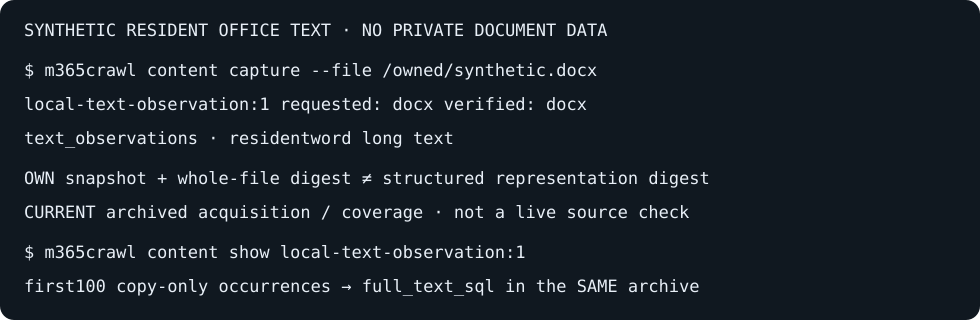
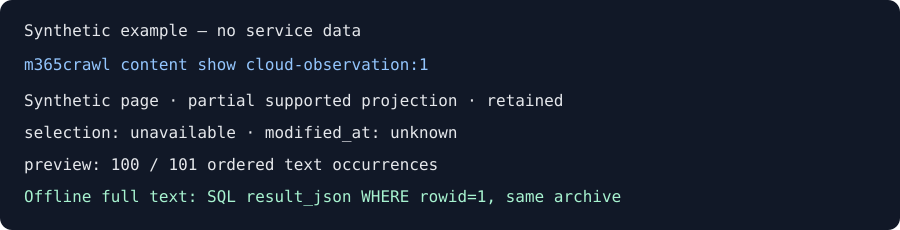

# Explicit content capture

Desktop caches are read by `sync`. Everything on this page is different: m365crawl captures it only when you run a `content` command that names the source. Ordinary `content list`, `content search WORDS`, `content show ID`, `content sources` and `search WORDS --source content` read the archive offline and never capture, fetch or sign in, regardless of `--max-age`.

There are three kinds of explicit content:

- [Resident Office text](#resident-office-text): one Word, Excel or PowerPoint file already on this computer.
- [SharePoint pages and Stream transcripts](#sharepoint-pages-and-stream-transcripts): one supported page or Stream URL, through the tool-owned browser.
- Engage: [bounded Home starters](engage-home.md) through `content fetch engage-home`, or [one selected thread](commands.md#content-fetch-engage-thread) through `content fetch engage-thread URL`, including observed starter/replies, native authors/times, safe links and generic attachment metadata. Both remain explicitly partial.

Every flag and result field is in [commands.md](commands.md#content-explicit-acquisition-offline-reads). [privacy.md](privacy.md) says what each one reads and stores.

## Resident Office text

Select one already-local ordinary file: `m365crawl content capture --file
/absolute/synthetic.docx [--kind docx|xlsx|pptx]`. Or follow a remembered native
file URL with `content capture --from document-observation:N`. Only the selected
original URL authorizes that proposal; FriendlyPath and titles never do.
No Office application, network, download, placeholder hydration or discovery
is involved. The native guard requires resident APFS with materialization disabled
on Mac or fixed NTFS with no recall/reparse on Windows. Linux acquisition is not
supported; archive reads are portable. Native platform qualification remains a
release gate, separate from synthetic parser tests and Windows cross-compilation.

Then use offline `content list/search/show/sources` or `search WORDS --source
content`. `local-text-observation:N` preserves supported paragraphs or cached
Excel values in order, including repeated occurrences and formula-cached flags.
Requested kind is intent; verified kind is null for compound unreadable files.
That state proves neither encryption nor a healthy empty document. Readable empty
projections supersede earlier nonempty text; partial/loss counts remain visible.
PDF, legacy Office, OCR, layout, decryption and recalculation are not supported.

Each item carries its **own** immutable native snapshot, whole-file byte digest,
structured representation digest and filesystem clock, separately from the
current archived explicit acquisition for **THAT source instance** and its coverage,
not the locator's newest incarnation or live source. An old instance may be retained
even when its own snapshot matches (`snapshot_match_scope`). Matching text does not
prove matching file bytes or native incarnation. Unknown generation creates
independent instances; observed zeros and unavailable clocks are not fabricated.
Year-one sentinel parsed clocks remain null with their exact raw evidence retained.
Ordinary reads never check the source, migrate or implicitly capture it.
Previews copy the first 100 occurrences, clip only displayed values/file labels,
and keep exact native IDs. `full_text_sql` reads the complete structured record
from the same archive. `local_content_coverage` survives fields, zero hits and
global clipping, with explicit file retry routes even after a failed first capture.

## SharePoint pages and Stream transcripts

`m365crawl content fetch page URL` explicitly acquires one supported rich-text
projection. `content fetch stream URL [--transcript-id ID]` acquires one verified
selected native transcript, or verified file/account metadata with no selected
body. Nothing is fetched by ordinary `content list`, `content search WORDS`,
`content show cloud-observation:N`, `content sources` or `search WORDS --source content`,
regardless of `--max-age`.

Supported targets are HTTPS `tenant.sharepoint.com` / `tenant.sharepoint-df.com`,
under `/sites/NAME` or `/teams/NAME`, ending in `/SitePages/NAME.aspx` or
`/_layouts/15/stream.aspx?id=ENCODED_FILE_PATH`. Sharing tickets and tracking
queries are never retained/replayed. The file path must belong to the admitted site.
This is not a library crawl, rendered layout, Office-file download or meeting transcript.

When the tool-owned browser profile needs sign-in, first ask the user to agree
to `content signin URL --user-agreed`. No ordinary browser authentication is copied.
Page scope is always partial; Stream completeness covers one selected bounded body,
not every variant. A retained body keeps its own account/file/selection and clocks,
alongside current source coverage and `selection_match` (matches/differs/unavailable).
`registration_id` retries an explicit target, `source_id` filters an admitted instance,
and `cloud-observation:N` never moves to a newer representation.

`content show` previews the first 100 text/entry occurrences. Native selections and
entry IDs are explicitly labeled `native_id_prefix` (at most 128 Unicode runes)
with `native_id_truncated`; complete structured evidence remains in `result_json`.
Run `m365crawl --db SAME_ARCHIVE sql 'select result_json from cloud_observations where rowid=N'`
using the generated positive N in `full_text_sql`. Native unknown modification
times/speakers stay unknown. Native Windows acquisition is not yet qualified;
portable offline archive reads do not imply Windows browser/service acceptance.

## Engage Home sessions

Explicitly `m365crawl content fetch engage-home`, then search/read offline with
`content search "words"`, `content show engage-observation:N` or shared
`search "words" --source content`. Preserve bounded native thread starters,
duplicate/empty blocks, immutable session IDs and original-session losses—not a
complete feed, replies, mentions, targeted thread or current revision.
`engage_content_coverage` separates unknown registration failures from unchanged
verified instances. Previews of the first 100 blocks and full-record SQL keep follow-up bounded and exact.
Optional agreed exact-root sign-in requires native identity plus terminal Close;
visible Home alone is not authentication. Offline reads are portable; live
Windows/Linux acquisition and interactive challenge/expiry remain unqualified.

[engage-home.md](engage-home.md) has the workflow, the evidence layers, limits and a synthetic visual.
