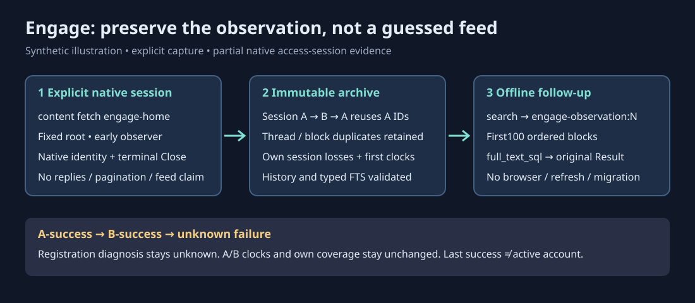

# Engage Home-session observations

Mixed content and shared search put every known native clock before every unknown
clock, then order newest-first and retain established equal-clock family ties.
Engage's explicitly known Go-zero remains known; legacy zero-without-presence
remains unknown. The exceptional old order of an undated legacy item before a
known pre-year-one item changes intentionally; stored evidence is unchanged.
Text output uses separate consecutive tables when row schemas differ, so
registration diagnostics and native instance/session evidence keep their own labels.



Explicitly capture native access-session thread starters:

```sh
m365crawl --db /absolute/private/archive.db content fetch engage-home
m365crawl --db /absolute/private/archive.db content sources
m365crawl --db /absolute/private/archive.db content search "planning"
m365crawl --db /absolute/private/archive.db content show engage-observation:1
```

The fetch accepts **no URL, thread ID, account selector or pagination**. It uses
only the tool-owned browser profile and fixed `https://engage.cloud.microsoft/`
root/Home workflow. It retains what the bounded native session supplied,
including observations before the Home action. This is not certified Home-feed
membership, a complete community feed, reply/mention capture, an atomic server
snapshot or a current thread revision.

## Read the three independent evidence layers

- **Registration:** each explicit attempt, including a first failure with no
  source instance. A failed/cancelled/timed-out/late-Close attempt has unknown
  account attribution. It never borrows the last successful account.
- **Verified instance:** exact native host/network/user plus mapper qualification.
  `last_successful_instance_id` is historical, not an active signed-in account.
  An unknown failure never changes an instance's clocks, session or coverage.
- **Immutable session and ordered occurrences:** repeated native thread IDs,
  empty blocks and duplicate blocks remain distinct. A-B-A representation reuse
  retains A's original occurrence IDs and first acquisition/admission clocks.
  Metadata-only is not no threads, no access, deletion or a healthy empty feed.
  Previously readable occurrences remain retained, not spliced into current Home.

`engage_content_coverage` is independent of `--fields`, limits and zero hits. It
contains registration diagnostics and body-free own-current-session summaries.
Detail labels the selected occurrence's **original session** losses separately
from current coverage. Session losses are not per-thread or multiplied per hit.

Native starter-updated time is the only text-modified clock. Thread activity and
starter-created clocks remain separate. Unknown native clocks are excluded by
bounded modified windows. An explicit year-one bound is still a bound, and a
nonnull year-one clock is known. Original offsets/raw strings are retained, even
when their UTC equivalent spills outside years 0–9999. The derived UTC duplicate
column is evidence to check, never a lexical date/order key or parser input.

## Preview, complete evidence and integrity

`--max-text N` caps each displayed block and title independently at N Unicode
code points, including a truncation ellipsis. A cut keeps N−1 code points plus
`…`; N=1 is only the marker. Exact-bound/shorter values stay unchanged and0 keeps
all text. This is not a byte, grapheme, terminal-width or aggregate-session
budget, and never changes native IDs, raw clocks or complete archived evidence.

List/search/detail preview the first **100 ordered blocks**, including empty
and repeated blocks. `blocks_total`, `preview_truncated` and `text_truncated`
explain clipping. Native IDs, raw clocks, version and nullable flags stay exact;
display clipping operates on copies, never the archived evidence.

Run the emitted `full_text_sql` with `m365crawl --db /same/archive.db --no-sync sql 'SQL'`
to read the full occurrence and its complete original session Result. The SQL
contains only a generated positive archive row ID; native identifiers are never
interpolated. No targeted-thread URL, person, task or document join is invented.
`full_text_command` is the ready-to-run equivalent: it quotes the same selected
archive and pins `--no-sync`. Run it as printed instead of accidentally invoking
generic SQL's implicit freshness workflow.

Every read audits complete retained canonical results, source binding, original
and reused memberships, frontiers and exact typed FTS provenance before
filtering—even at zero hits or global clipping. Corruption fails explicitly;
ordinary reads and reuse never repair it. Reads never observe a profile/source,
refresh, sign in, acquire or migrate, including with `--max-age 1ns`.
Store snapshots with an unspecified output limit default to128 and mark
`truncated`; CLI list/search keep their explicit requested limits. A fetch reads
a body-free audited receipt with only its own at-most128 ordered occurrence IDs,
never assembles the full historical archive merely to discover a capture receipt.

## Sign-in is a separate explicit lifecycle

Only after user agreement:

```sh
m365crawl --db /absolute/private/archive.db content signin https://engage.cloud.microsoft/ --user-agreed
```

Exact HTTPS root/default443 only; no query, fragment, userinfo or alternate port.
Visible native Home is preliminary readiness, not authentication. Verification
requires positive native viewer/network evidence and successful terminal browser
Close, within the bounded five-minute sign-in work lifetime. If fewer than
45 seconds remain, verification is refused, not retried or extended. All
observed content is discarded; sign-in does not register or admit a capture.
Generic unavailable/redirect/identity/timeout errors remain authentication
unknown, not proof of wrong credentials, no access or required sign-in.

## Platforms, upgrades and support

Offline archive reads are portable. Synthetic/native browser fixtures do not
qualify live Windows/Linux service acquisition or interactive challenge/expiry.
Actual Mac consumer acceptance, native CI and the normal reviewed release/install
gates remain required; backend proof alone is not consumer delivery.

The next ordinary writable open migrates schema17 to additive schema18;
read-only old archives return not-registered optional coverage without migration.
Use normal signed/notarized macOS release artifacts or Homebrew (macOS only).
Windows release assets are intentionally unsigned. Protect the private archive
and browser profile like the mailbox; never publish native payloads in reports,
fixtures or issues. See [privacy](privacy.md) and [release process](releasing.md).

For one exact Engage thread or Teams Engage deep link, use [`content fetch engage-thread URL`](commands.md#content-fetch-engage-thread) to retain observed starter/replies, authors/times, safe links and generic attachment metadata with explicit partial/loss reporting. Home's own no-selector/starter-only contract above is unchanged. For another service or workflow, work with your agent to open a **prompt request**; do not infer support or improvise a token client.
