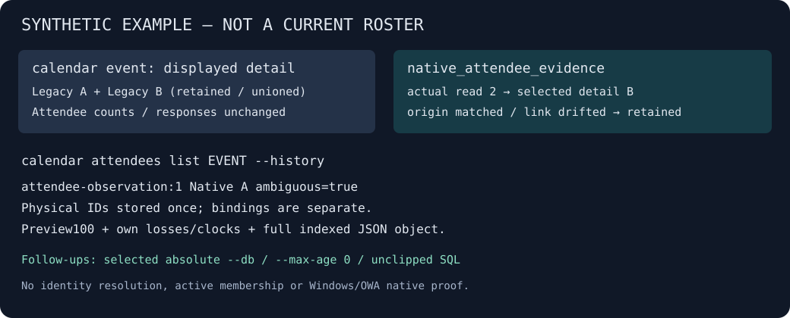

# Notes, documents, people, attendees and Loop

Teams chats, Outlook mail and the calendar arrive with `sync`. Five more local sources each have their own explicit `sync` that registers them, and their own `sources` command that shows coverage. Nothing on this page is fetched from the network, and every example is synthetic.

| Source | Register | Follow up | Reference |
| --- | --- | --- | --- |
| [OneNote indexed notes](#onenote-indexed-notes) | `notes sync` | `notes show note:ID` · `notes sources` | [commands](commands.md#indexed-notes) |
| [People observations](#people-observations) | `people sync` | `people show person-observation:ID` · `people sources` | [commands](commands.md#people) |
| [Native meeting attendee evidence](#native-meeting-attendee-evidence) | `calendar attendees sync` | `calendar attendees list <event>` · `calendar attendees show attendee-observation:N` · `calendar attendees sources` | [commands](commands.md#calendar-attendees-sync) |
| [Document metadata](#document-metadata) | `docs sync` | `docs show document-observation:ID` · `docs sources` | [commands](commands.md#document-metadata) |
| [Cached Loop channels](#cached-loop-channels) | `loop sync` | `loop show loop-channel:ID` · `loop sources` | [commands](commands.md#cached-loop-channels) |

Shared `search` joins notes, people, documents and Loop to chats and mail once they are registered. Native meeting attendee evidence is inspected through its calendar commands, not added to the people index or shared search.

## OneNote indexed notes

**OneNote, without pretending an index is a notebook export.** `notes sync` registers the available Mac indexes; `notes sync --root DIR` accepts supported rollback-mode index copies on Mac, Windows and Linux. Shared search joins their titles, text and OCR to conversations and mail. `notes show note:ID` preserves native elements, flags and hierarchy; `notes sources` shows coverage, failures and last-good capture. Partial or failed captures keep prior text. No original visual layout, page web link, author or tenant ownership is invented. Native Windows app-cache discovery and live WAL capture remain deferred.

If you use OneNote on Mac, add its locally indexed notes explicitly:

```sh
m365crawl notes sync
m365crawl notes sources
m365crawl search "launch checklist"
m365crawl notes show note:ID
```

Ordinary note reads refresh registered sources only. New indexes need another explicit `notes sync`; `--no-sync` performs no capture. Account, author, chat-only and mail-only filters exclude unresolved notes from combined search with a notice. Use `--source notes` for an independent notes-only search that does not require Teams or Outlook.

<p align="center"></p>

*Find the note, then read the evidence. This example is actual CLI output from synthetic notes, not private work data or a complete notebook export.*

[how-it-works.md](how-it-works.md#onenote-indexed-notes-a-separate-local-capture) explains how an index is captured.

## People observations

**People observations, without invented identity resolution.** `people sync` registers native Mac Outlook HxStore inputs, and `people --query` joins retained observations to the existing people list. `people show person-observation:ID` exposes native email/directory claims, differing copies and conflicts; `people sources` shows independent coverage. Copied supported HxStore roots work with `--root`. Windows OWA people discovery and automatic subject-tenant resolution are not supplied. A profile-owner link is not the subject's tenant, a cache refresh is not last contact, and ambiguous copies remain unresolved rather than becoming a guessed current contact.

```sh
m365crawl people sync
m365crawl people --query "name or address"
m365crawl people show person-observation:ID
```

<p align="center"></p>

*Find the name, inspect the claims, and keep uncertainty visible. These are synthetic observations, not private contacts or a directory export.*

## Native meeting attendee evidence

Explicitly run `m365crawl calendar attendees sync` for Mac HxStore discovery,
or `calendar attendees sync --root DIR` for a supported copied profile root.
Then use strictly offline `calendar attendees sources`, `list <event>` and
`show attendee-observation:N`, even with `--max-age 1ns`.
Inspect `native_attendee_evidence` separately from the existing event roster:
it records the actual reader-selected source detail, not retained/unioned display
attendees, active people, resolved identities or current membership.

Own-snapshot ambiguity, original losses/clocks and independent event/detail
bindings survive preview100, fields and zero hits. Physical observation IDs are
unique per result; multiple parent bindings are separate relationships, not
additional people. Exact full-record SQL extracts one complete indexed native
object; full-capture SQL reads its immutable snapshot. Follow emitted routes
with their selected absolute archive and `--no-sync`.
Use independent `own_captures` routes to recover the full historical snapshot,
including bindings beyond the100-entry preview. These deduplicated routes survive
fields and are bounded by at most100 rows plus100 bindings; current source health
and its capture route remain separately current, not relabeled as history.

Shared ordinary Outlook capture refreshes registered lanes from the same private
copy. All eligible readers close before one verified cleanup and optional admission.
Standalone capture leaves mail intact and ensures the next eligible ordinary read
still catches up mail. It does not force repeated global recapture.
An existing unknown calendar origin refuses standalone capture before changing
calendar/mail/native state. After verifying the requested original source,
bootstrap through the emitted ordinary eligible-sync route for that exact root
and selected archive, then retry the original request. A same profile basename
never proves ownership of the old partition.
Native Windows/OWA acquisition remains unqualified; portable archive reads and
fixture cross-compilation do not prove it. Current and historical results audit
their relevant canonical bodies, not unrelated unshown history.
[Command contract](commands.md#calendar-attendees-sync).



## Document metadata

**Document evidence, without opening the document.** `docs sync` captures available Mac Office recent/shared/recommended/dialog metadata; shared search then connects native titles, URLs and sharing/person claims to the conversation. Follow `document-observation:ID` with `docs show`, narrow lists with `--application Word|Excel|PowerPoint` and `--surface recent|shared|recommended|dialog`, and inspect `docs sources` for losses, failed inputs with their remedy, and retained claims. Explicit ordinary local JSON copies use `docs sync --root DIR`; provider/placeholder and linked inputs are refused.

**Office registry.** `docs sync` also reads the Mac Office registry's recently-opened list, and `docs sync --registry-file FILE` reads one ordinary local copy of a registry file: those rows carry the registry's own opened time (`opened_at`, null when it does not parse) and no modification time, so date filters never match them.

**OneDrive usage.** `docs sync` also reads OneDrive's local usage file on Mac, and `docs sync --onedrive-usage-file FILE` reads one ordinary local copy of it on Mac or Windows: recently used files, their formatted variants with the sharing claims OneDrive recorded, and frequent-collaborator profiles (`--application onedrive`, `usage_native`). Sharing history and participants are previewed at 100 with full counts, each row prints the command that shows its complete stored record, and the names, addresses and thread IDs in it stay the file's claims, never linked to an archived person or chat. A usage file with a write-ahead log beside it is refused rather than consolidated.

Metadata is not document text, a resolved file identity, current sharing or proof of local residency. Native URLs and friendly paths are never opened or hydrated, and identical sharing claims are not counted as new events. Start from `docs --help`: the embedded guide adds workflow strategy, not missing command contracts. To capture the text of one resident Office file, see [explicit content capture](content.md#resident-office-text).

```text
$ m365crawl --fields id,title,application,surface,opened_at,text_state docs list --query Orion
id                      title                           application  surface  opened_at             text_state
----------------------  ------------------------------  -----------  -------  --------------------  ------------
document-observation:3  Synthetic Orion budget draft    registry     -        2026-10-09T12:34:56Z  not_captured
document-observation:1  Synthetic Orion planning notes  supplied     recent   -                     not_captured
document-observation:2  Synthetic Orion shared plan     supplied     shared   -                     not_captured

documents coverage: registered (office_document_metadata)
source  kind             status    coverage      locator                                         reason
------  ---------------  --------  ------------  ----------------------------------------------  ------
1       office_recent    complete  observations  office/recent.json                              -
2       office_shared    complete  observations  office/shared.json                              -
3       office_registry  complete  observations  registry/MicrosoftRegistrationDB_synthetic.reg  -
3 items

$ m365crawl --fields id,title,variant,opened_at,modified_at,association_state,text_state docs show document-observation:3
id                      title                         variant          opened_at             modified_at  association_state  text_state
----------------------  ----------------------------  ---------------  --------------------  -----------  -----------------  ------------
document-observation:3  Synthetic Orion budget draft  office_registry  2026-10-09T12:34:56Z  -            unresolved         not_captured

documents coverage: registered (office_document_metadata)
source  kind             status    coverage      locator                                         reason
------  ---------------  --------  ------------  ----------------------------------------------  ------
3       office_registry  complete  observations  registry/MicrosoftRegistrationDB_synthetic.reg  -
1 items
```

*Find the claim, inspect the source, and leave unresolved links unresolved. This is actual output of this version from synthetic Office JSON files and a synthetic registry file (times in UTC), not private documents or a library export.*

## Cached Loop channels

**Cached Loop channels, as partial snapshots.** `loop sync` projects the channel text of Loop snapshot records Teams already cached and `sync` already archived; nothing is fetched and Loop is never opened. Shared search and `loop search` return stable `loop-channel:ID` rows to follow with `loop show`. Each row is one channel of one immutable snapshot version, with its native sequence, pending-operation count and whether the archived record still matches it: partial text, not a full or current page, table, author or history. `loop sync` takes 128 new records per run and says when to run it again. `loop sources` shows every registration, including failed and metadata-only ones, with the retry command.

```sh
m365crawl loop sync
m365crawl loop search "words"
m365crawl loop show loop-channel:ID
```
